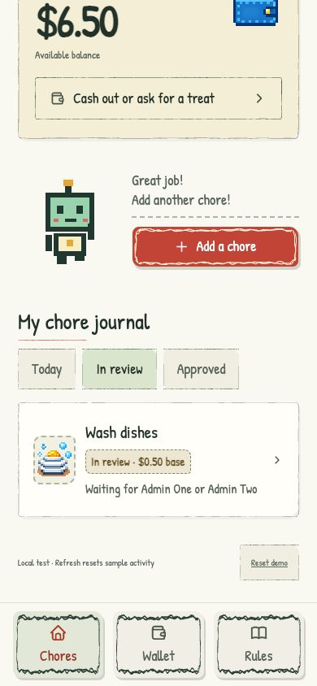
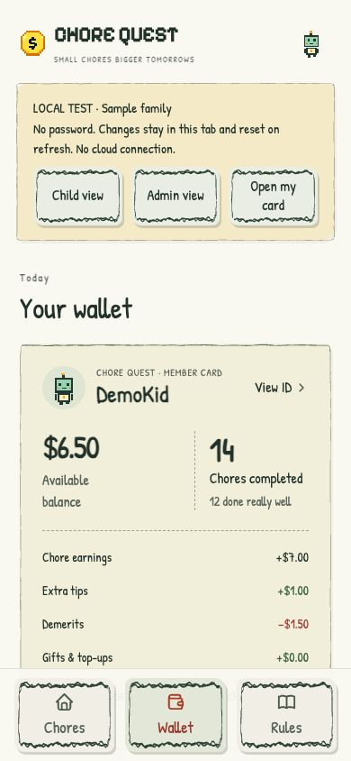
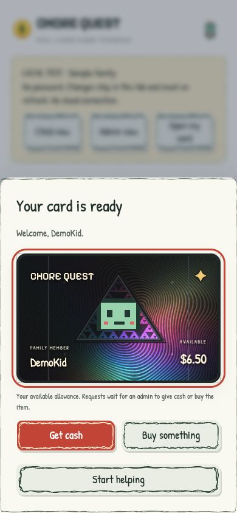
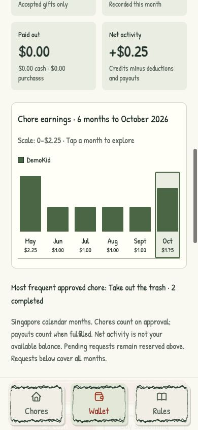
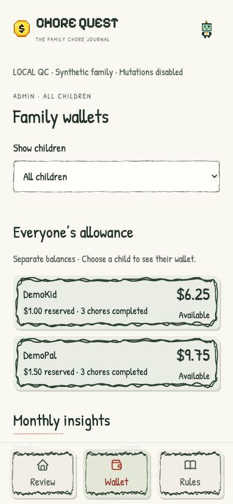

# Chore Quest Community

A small chore journal for families who want to keep photos, rewards and allowance requests in one place.

Children submit completed chores with a photo. An adult reviews the work, chooses a tip and confirms the reward. The wallet keeps a record of what was earned, given, deducted or paid out. Monthly graphs make it easier to see how things are going.

The interface uses handwriting, sketch borders and a little pixel robot called Buddy. Everything runs in the browser, with a Cloudflare Worker and D1 database for the hosted version.



## Try it locally

Download this repository with GitHub’s **Code → Download ZIP** button and unzip it, or clone it with Git. Install Node.js 22.18 or newer, open a terminal in the project folder, then run:

```sh
npm ci
npm run preview
```

Open **http://127.0.0.1:8790**. The demo has fictional accounts and sample balances. No login is needed, and refreshing resets your changes. Stop the server with Ctrl+C.

For a real household, follow [the setup guide](docs/SETUP.md). You will need your own Cloudflare account, database and setup secret. This repository does not connect to anyone else's household.

## What it does

- Photo submissions, adult review, tips and requests to redo a chore.
- Separate child and admin permissions, with invitations for new accounts.
- Cash and purchase requests that reserve funds until an adult completes or declines them.
- Gift QR codes that the intended child scans and confirms inside the app.
- Admin-created rules and deductions.
- Monthly chore, earnings and payout graphs, plus transaction history.
- A member card with a holographic effect and a gift receipt animation.
- Home-screen installation support, with a network connection still required.

An approved basic chore earns 50 cents. Adults choose any extra tip. Currency formatting and reporting currently use dollar amounts and Singapore calendar months; see [architecture](docs/ARCHITECTURE.md) before adapting those defaults.

| Wallet | Member card |
| --- | --- |
|  |  |

| Monthly insights | Admin view |
| --- | --- |
|  |  |

## Before using it with real data

This is a household allowance journal. It does not move bank funds or make purchases. An adult still hands over the cash or buys the item.

The hosted app protects records with sign-in and server permission checks. Its login page and generic assets are public. Data is stored in your Cloudflare account; it is not end-to-end encrypted. There is no password-reset or account-deletion screen yet. Make a backup and retention plan before relying on it.

Photo storage is bounded: 20 MB per child, 80 MB per deployment and five unattached uploads per child. Unattached uploads older than 24 hours are removed when the next photo is uploaded. Photos linked to chores are preserved. These limits are deliberately small and can be reviewed in migration `0005_photo_limits.sql`.

The [security notes](SECURITY.md) describe reporting and review limits. Passing tests are useful evidence, not a guarantee that software has no vulnerabilities.

## Work on the app

```sh
npm test
npm run docs:check
npm run build
```

Read the [architecture](docs/ARCHITECTURE.md), [flowcharts](docs/FLOWS.md) and [contribution guide](docs/CONTRIBUTING.md). The project uses plain JavaScript; there is no frontend framework to learn.

The [credits](CREDITS.md) list the graphic sources, fonts, adapted code and licenses. Application code and original community artwork are available under [MIT](LICENSE); bundled third-party files keep their own licenses. OpenAI Codex helped with implementation, testing, the public-edition review and documentation.
